# 🩺 NeuroReflex IoT — Real-Time Telemetry Dashboard
### Diabetic Neuropathy & Peripheral Ischemia Diagnostic Monitoring System
**PRBL Semester 5 Engineering Project**

[](https://diabetes-nerve-damage-detection.vercel.app)
[](https://www.espressif.com/)
[](docs/patent/patent_publication_proof.jpg)

---

## 📜 Intellectual Property & Official Patent Publication

> **Patent Title:** *A SMART WEARABLE DEVICE FOR EARLY, NON-INVASIVE DETECTION OF DIABETIC NERVE DAMAGE*  
> **Application No:** `202641133545 A`  
> **Date of Filing:** 06/11/2026 | **Publication Date:** 13/11/2026  
> **International Classification:** `A61B 5/00`, `A61B 5/0488`, `A61B 5/11`, `A61N 1/36`, `A61B 5/04`  
> **Applicants:** M. Kumarasamy College of Engineering, K. Ramakrishnan College of Engineering, K. Ramakrishnan College of Technology  
> **Inventors:** Dr. D. Mercy, Jeya Krishnan T, Kaiser Rahman M, Loginath A, Mr. A. Mohana Krishnan, Balaganesan G  

<p align="center">
  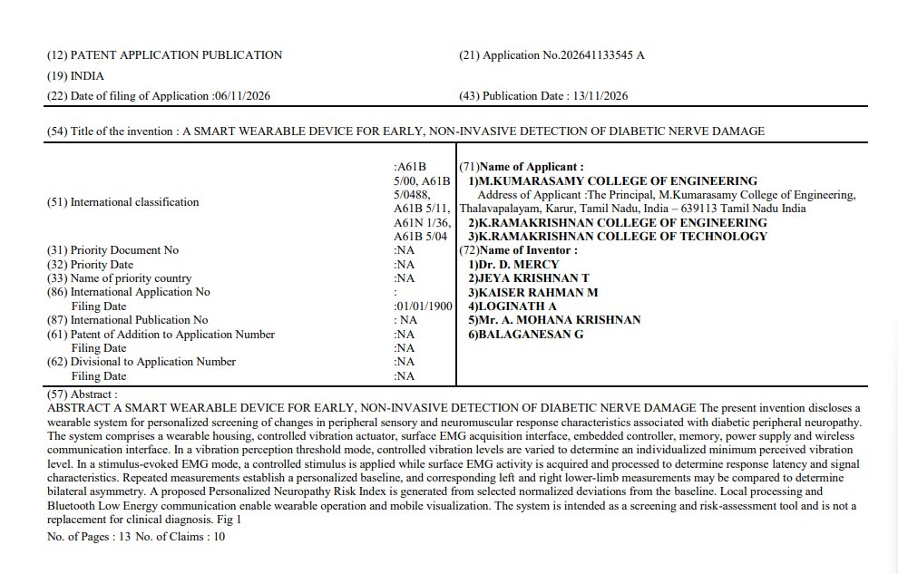
  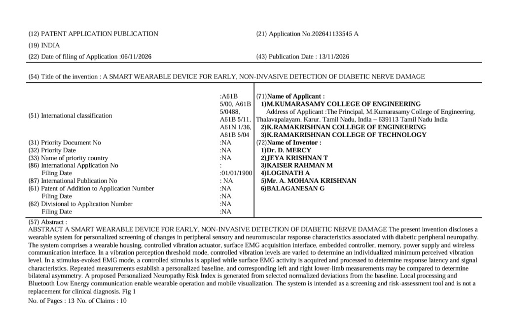
</p>

---

## 🌟 System Overview & Innovation
NeuroReflex is an end-to-end wearable medical screening and diagnostic workstation that detects early signs of Diabetic Peripheral Neuropathy (DPN) and lower-limb peripheral ischemia through:
1. **Skin Surface Thermometry:** Measures rapid microvascular cooling thresholds (< 25.5°C) to identify compromised peripheral circulation and ischemia.
2. **Tactile Vibration Stimulus:** Controlled haptic motor pulse triggers the patient's mechanoreceptors.
3. **Reflex Response Latency:** Measures the exact neuromuscular response time (stopwatch latency) upon tactile perception.
4. **Surface EMG (Electromyography):** Captures real-time bio-potential muscle firing dynamics using the AD8232 analog front-end.
5. **Real-Time Web Telemetry:** Streams bidirectional telemetry to a modern web application via Web Serial (115200 Baud) or Wi-Fi WebSockets.

---

## 🖥️ Real-Time Telemetry Dashboard

Live deployment: [diabetes-nerve-damage-detection.vercel.app](https://diabetes-nerve-damage-detection.vercel.app)

### 1. Normal Baseline Monitoring & Real-time EMG Trace
Continuous real-time skin temperature readout, bio-potential oscilloscope trace (with moving average filter), and sensor connection status.

<p align="center">
  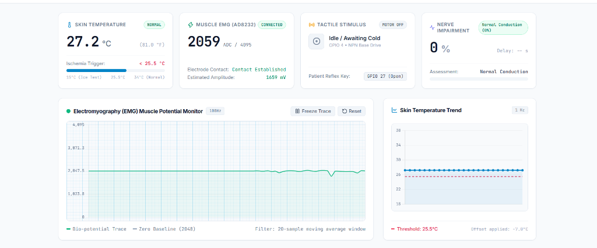
</p>

### 2. Ischemia Alarm Trigger & Stimulus Active Mode
Visual clinical alert when temperature drops below 25.5°C, automatically engaging the plantar nerve tactile stimulator and beginning reflex latency acquisition.

<p align="center">
  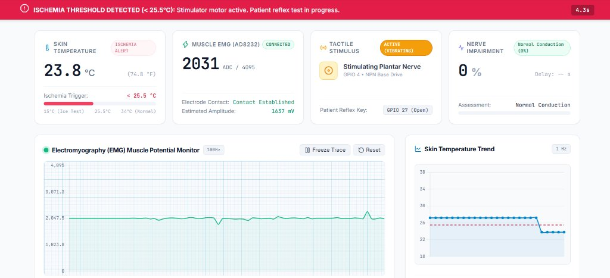
</p>

### 3. Diagnostic Protocol Guide, Trial Examination History & Serial COM Monitor
Comprehensive clinical testing guide, trial examination logging, and integrated 115200 Baud serial terminal diagnostics directly in the browser.

<p align="center">
  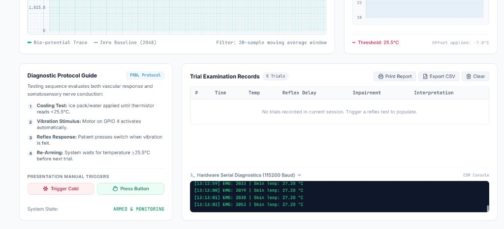
</p>

---

## 📐 System Architecture & Hardware Design

### 1. System Block Diagram
<p align="center">
  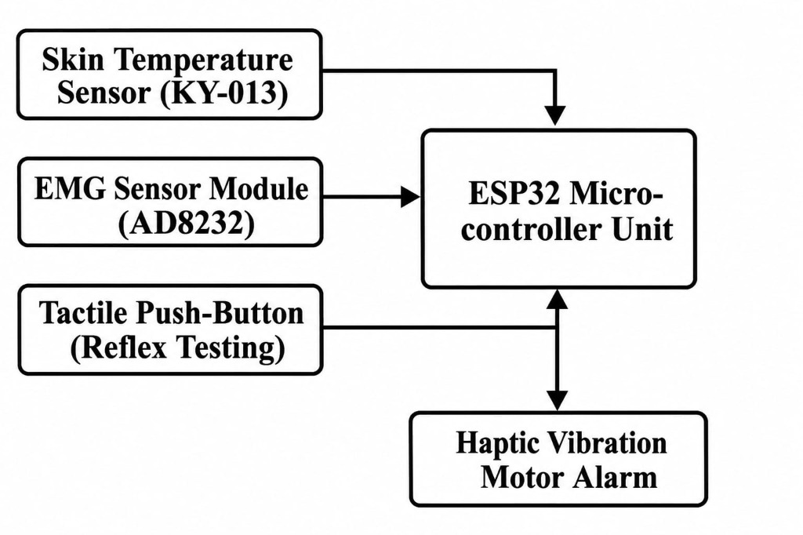
</p>

### 2. Circuit Schematic Diagram (KiCad)
<p align="center">
  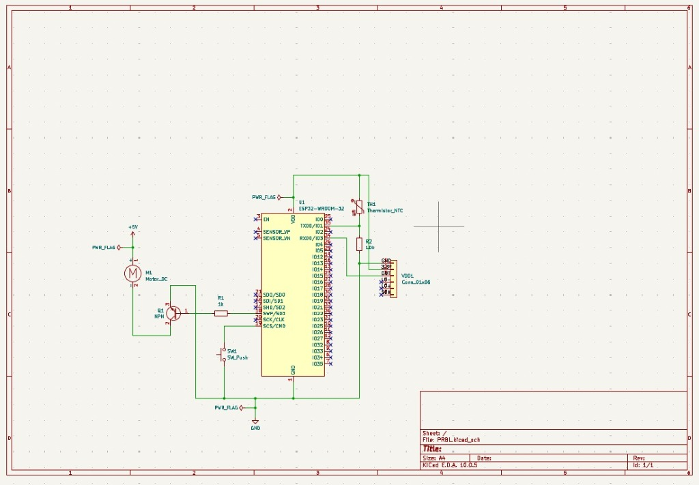
</p>

### 3. PCB Layout & 3D Render
<p align="center">
  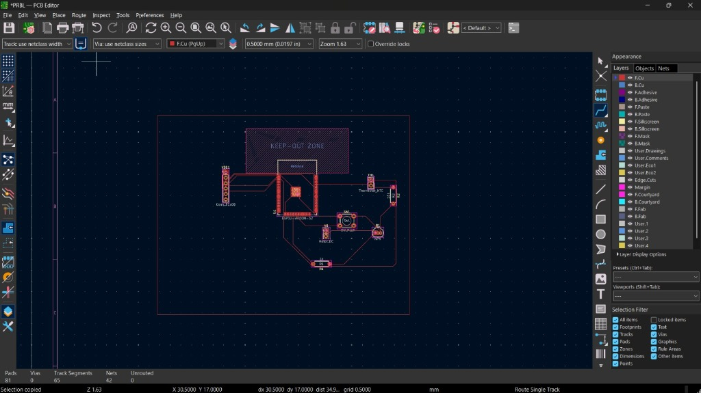
  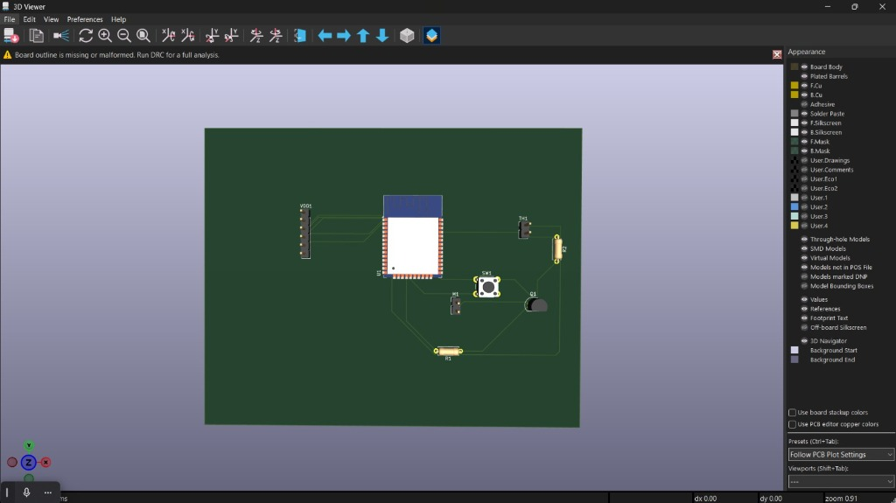
</p>

### 4. EMG Electrode Placement Guide (AD8232)
Three-lead surface EMG electrode placement (Red, Yellow, Green) for accurate bio-potential capture:

<p align="center">
  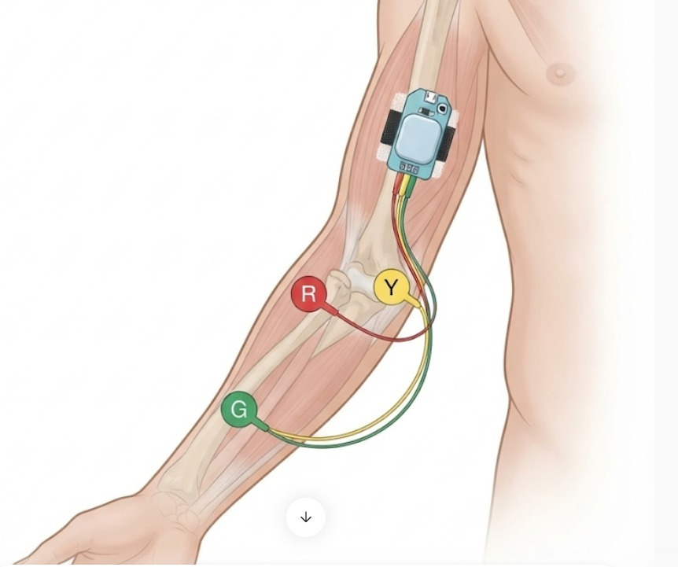
</p>

---

## 🔬 Working Physical Prototype

The physical wearable unit integrates the ESP32 microcontroller, AD8232 EMG sensor interface, skin thermistor, haptic vibration actuator, tactile patient reflex switch, and biomedical gel electrodes into a flexible ergonomic strap.

<p align="center">
  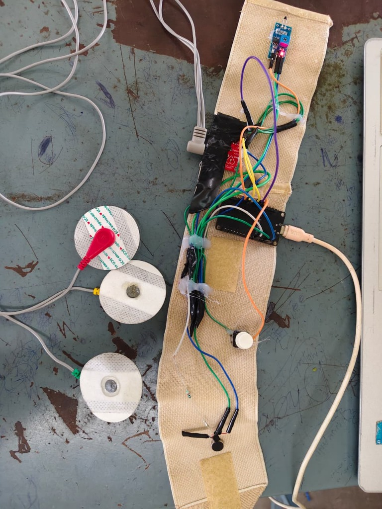
  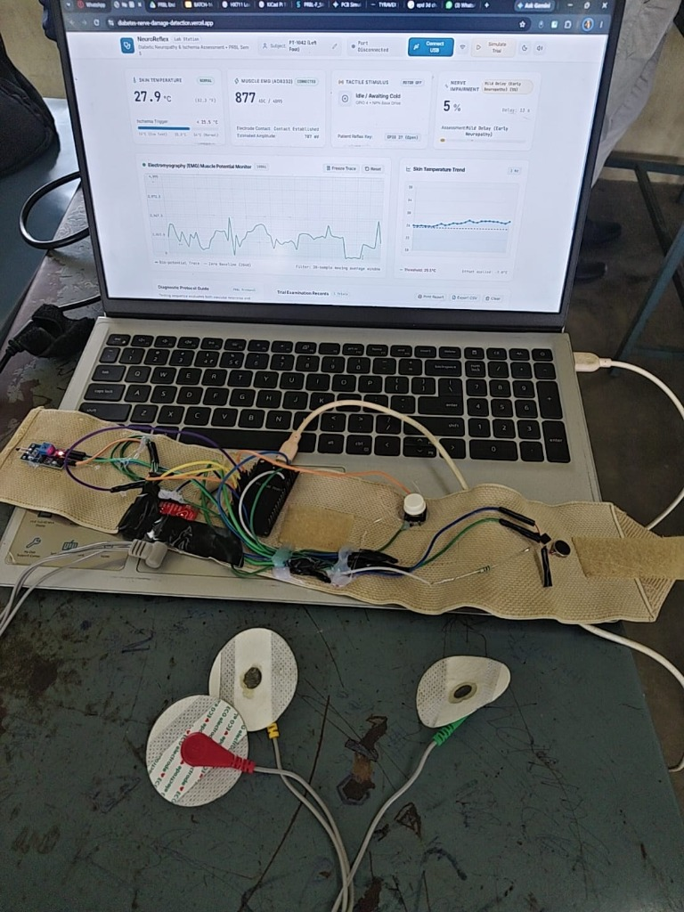
</p>

<p align="center">
  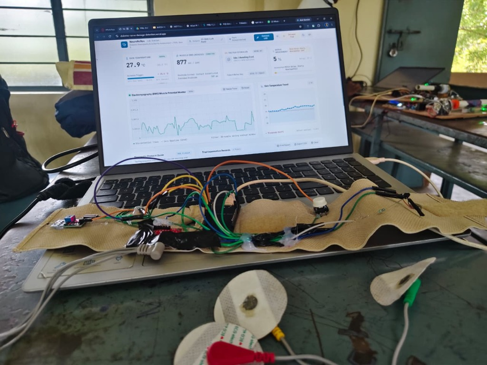
</p>

---

## 🔌 Hardware Pinout Reference (ESP32 38-Pin)

| Hardware Component | ESP32 Pin | Mode | Purpose |
| :--- | :--- | :--- | :--- |
| **Vibration Motor (NPN Base)** | `GPIO 4` | `OUTPUT` | Tactile stimulus upon cold/ischemia detection |
| **AD8232 Lead-Off Minus (LO-)** | `GPIO 25` | `INPUT` | Electrode disconnection check |
| **AD8232 Lead-Off Plus (LO+)** | `GPIO 26` | `INPUT` | Electrode disconnection check |
| **Patient Tactile Push Button** | `GPIO 27` | `INPUT_PULLUP` | Patient response trigger (Active LOW) |
| **KY-013 Thermistor (AO)** | `GPIO 34` | `ANALOG INPUT` | Skin temperature measurement |
| **AD8232 EMG Analog Out** | `GPIO 35` | `ANALOG INPUT` | Muscle biopotential measurement |

---

## 🧮 Nerve Damage Calculation Formula
As programmed in the Arduino/ESP32 firmware:
- If reflex delay is $\le 5$ seconds: **$0\%$ Damage (Normal Conduction)**
- If reflex delay is $> 5$ seconds:
  $$\text{Nerve Damage (\%)} = \left(\frac{\text{Delay} - 5}{5}\right) \times 5\%$$
- If delay $\ge 105$ seconds (Timeout): **$100\%$ Sensory Loss**

---

## 🚀 How to Run the Website

### Method 1: Instant Browser Launch (Recommended)
1. Open Google Chrome, Microsoft Edge, or Opera.
2. Double-click `index.html` (or right-click `index.html` > **Open with Google Chrome**).
3. Connect your ESP32 to your PC via USB.
4. Click the cyan **"Connect ESP32 (USB)"** button in the top navigation bar.
5. In the browser popup, select your ESP32 COM port and click **Connect**.
6. The dashboard will immediately start plotting live telemetry!

> **Note:** Web Serial API is natively supported in Chromium-based desktop browsers (Chrome, Edge, Opera, Brave).

### Method 2: Local HTTP Server (Optional)
```powershell
# Using Python:
python -m http.server 3000
# Then open http://localhost:3000 in Chrome/Edge

# OR using Node.js:
npx serve .
```

---

## 🧪 Demonstration / Viva Features
- **Demo Simulation Button**: Lets you preview the entire clinical workflow without plugging in any hardware.
- **Trigger Cold/Ischemia Button**: Simulates temperature dropping below 25.5°C, turning on the motor and starting the reflex timer.
- **Press Patient Button**: Simulates patient pressing the switch, calculates delay and nerve damage, and records the test to the table.
- **Export CSV Button**: Downloads a clinical test report spreadsheet for lab records and semester 5 documentation.
